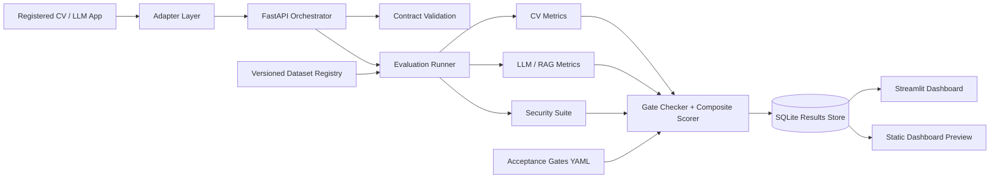

# AI Benchmarking Suite v2 Architecture

## Request lifecycle

1. An application is registered with its type, endpoint, and latency budget.
2. An adapter normalizes application output to the CV or LLM contract.
3. The orchestrator runs the relevant accuracy, operational, and safety metrics.
4. Composite scoring remains separate from the hard security gate.
5. The immutable run record stores dataset version, hardware profile, commit, metrics, and gate results.
6. Dashboard surfaces read the stored results for trend and drill-down views.

## Deployment boundary

The v2 design is local-first. Model weights, datasets, adapters, and results can stay inside an air-gapped environment. The API and dashboard are optional presentation layers over the same Python metric engine.
